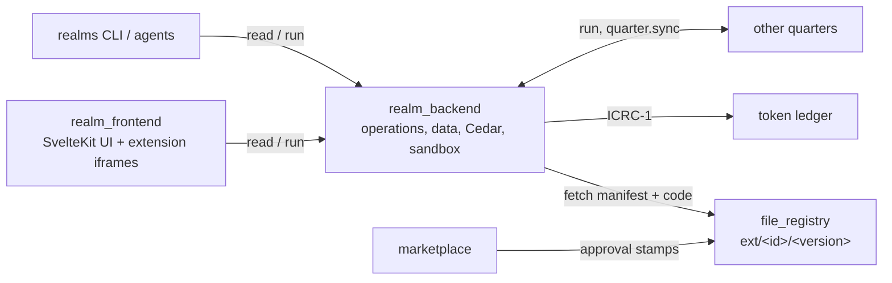
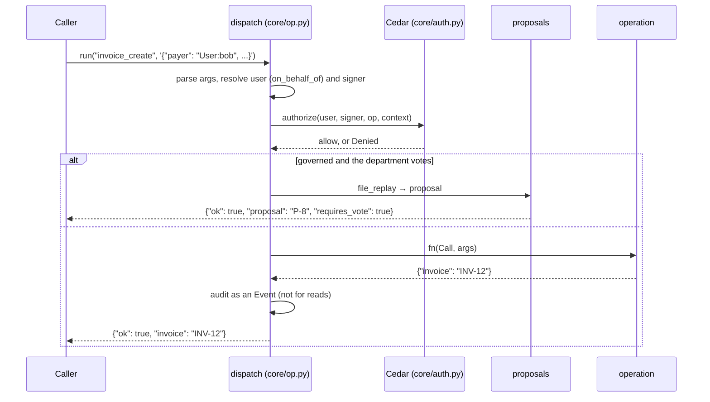

# Architecture

A realm is a Python canister with one public API: call an **operation** by name, with JSON
arguments, and get JSON back. Every caller (the web UI, the CLI, AI agents, extensions, codices,
passed proposals, other quarters) goes through the same path, so the same authorization, audit and
governance rules apply to all of them.

## Canisters



| Canister | Source | Role |
|---|---|---|
| `realm_backend` | [`src/realm_backend`](../../src/realm_backend) | All data and logic. Python on [Basilisk](https://github.com/smart-social-contracts/basilisk). |
| `realm_frontend` | [`src/realm_frontend`](../../src/realm_frontend) | The UI (SvelteKit, asset canister). Hosts extension UIs. |
| `file_registry` | [file-registry](https://github.com/smart-social-contracts/file-registry) | Stores published extensions and codices. |
| `marketplace_backend` / `_frontend` | [`src/marketplace_*`](../../src) | Lists packages, reviews them, stamps approvals on the registry. |
| Token and NFT ledgers | [ic-tokens](https://github.com/smart-social-contracts/ic-tokens) | ICRC-1 money and land titles. |

## The backend in layers

The backend is about 6,600 lines, with a hard budget of 10,000
([`scripts/loc_budget.py`](../../scripts/loc_budget.py)).

```text
src/realm_backend/
├── main.py         two endpoints: read (query) and run (update); init and post_upgrade
├── core/           the kernel, with no domain logic
│   ├── op.py       @op registry and dispatch: the single entry point
│   ├── auth.py     Cedar schema, policies, guardrails; permission resolution
│   ├── sandbox.py  subinterpreters for codex hooks and extension backends
│   ├── sdk.py      ggg_sdk, the module codex hooks import
│   ├── db.py       Row, Fail, Json, find, pagination helpers
│   ├── chain.py    caller, time, timers, inter-canister calls
│   └── candid.py   parses Candid text replies of other canisters
├── ggg/            the GGG entities: data only, no behaviour
└── api/            one module per domain: members, orgs, proposals, delegation,
                    treasury, taxes, assets, licenses, justice, procurement,
                    quarters, federation, codex, extensions, tasks,
                    notifications, crypto, setup
```

Rules that keep it small: entities hold no logic, operations hold no permission checks or error
wrapping, and there is exactly one way into backend logic. See
[design choices](design-choices.md).

Data is stored with [ic-python-db](https://github.com/smart-social-contracts/ic-python-db) in a
`StableBTreeMap` in stable memory, so it survives upgrades without migration code.

## The life of a call



Errors come back as `{"ok": false, "error": "..."}`. An unexpected exception traps, which rolls
back every change of the call. Details: [operations](operations.md).

## Who can call, and how

| Caller | Path | Origin | Limited by |
|---|---|---|---|
| UI, CLI, agents | `read` / `run` endpoints | `user` | The caller's permissions |
| Delegate | `run` with `on_behalf_of` | `user` | The grant's scope; delegable, non-signing ops |
| Extension backend | `extension_call` → sandbox → `rpc(op, …)` | `extension` | The calling user's permissions and the extension's declared ops |
| Extension UI | bridge → `read` / `run` | `user` | The declared ops (in the bridge) and the user's permissions |
| Codex hook | effects returned by the hook | `codex` | The codex's declared capabilities |
| Passed proposal | replay of its action, as the proposer (the grantor, under power of attorney) | `replay` | Nothing more: the vote was the authorization, within the proposal's department |
| REPL | `shell` op → sandbox → `ops.<name>()` | `shell` | The caller's permissions |
| Another quarter | `run` from a registered quarter | `user` | `quarter.sync` |

## Where to go next

| Topic | Page |
|---|---|
| Why Python, why stable memory, why a single entry point | [Design choices](design-choices.md) |
| Writing and calling operations | [Operations](operations.md) |
| Who may do what | [Authorization](authorization.md) |
| How untrusted code is contained | [Sandboxing](sandboxing.md) |
| Votes, governed calls, power of attorney | [Governance and delegation](governance-and-delegation.md) |
| Scaling out to many canisters | [Quarters and federation](quarters-and-federation.md) |
| Where code comes from and why the realm trusts it | [Trust and the registry](trust-and-registry.md) |
| The UI and extension UIs | [Frontend](frontend.md) |
| Every entity and operation | [GGG spec](../ggg/spec.md) |
