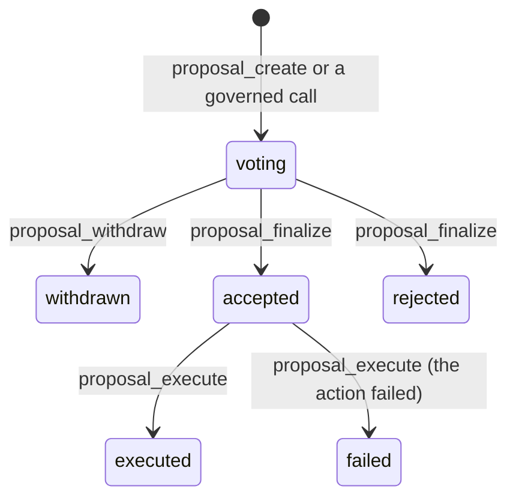

# Governance and delegation

A realm decides things in three ways: a member acts with a permission they hold, a body votes,
or someone acts for another person under a power of attorney. All three go through the same
operations; the code is [`api/proposals.py`](../../src/realm_backend/api/proposals.py),
[`api/orgs.py`](../../src/realm_backend/api/orgs.py) and
[`api/delegation.py`](../../src/realm_backend/api/delegation.py).

## Departments and policies

Every realm has a root department, `Administration`, and any number of departments under it
(`Civil Registry`, `Justice`, …). People hold **positions** (seats) in departments through
**appointments**. An active appointment gives the seat's permissions (see
[Authorization](authorization.md#where-permissions-come-from)).

Each department has an approval **policy**, set with `department_set_policy`:

```json
{"department": "Civil Registry", "m": 2, "n": 3, "quorum_percent": 0, "veto": ["dana"]}
```

- `m` of `n`: how many yes votes the department needs, out of its seats.
- `quorum_percent`: turnout needed (0 to 100).
- `veto`: seated members whose *no* rejects the proposal.

A policy is **direct** when `m ≤ 1`, `n ≤ 1`, there is no quorum and no veto. A department with no
policy is direct.

## Governed operations

An operation declared `governed=` names the department that governs it:

```python
@op("extension.install", governed=realm_wide)               # the root department
def extension_install(c, args): ...

@op("user.add", governed=in_charge("user.add"))             # the department named in args
def user_add(c, args): ...
```

When someone calls a governed operation:

- If the governing department's policy is **direct**, the operation runs at once (it is still
  authorized by Cedar and audited).
- Otherwise the call **does not run**. It files a proposal instead and replies
  `{"ok": true, "proposal": "P-12", "requires_vote": true}`. If the proposal passes, the exact call
  is replayed.

So a small realm can start with no policy and act directly, then add a policy to the root
department when it wants votes. Setup is a special case: during setup the founder configures the
realm directly; after `setup_launch`, configuration is governed by the root department.

## The life of a proposal



| Step | Operation | Notes |
|---|---|---|
| File | `proposal_create` | `title`, `description`, `department` (default: the realm), optional `action` `{op, args}`. Voting opens at once. |
| Vote | `proposal_vote` | `choice`: `yes`, `no` or `abstain`. Voting again replaces your vote. Delegable. |
| Close | `proposal_finalize` | Records accepted or rejected. |
| Act | `proposal_execute` | Replays the action once, with origin `replay`, as the proposer (the grantor, for a call made under power of attorney). A department's proposal may only carry actions that department, or one under it, governs; a realm-wide proposal may carry any. |

The voting window comes from the realm's calendar (default 7 days). `governance_update` changes
it, along with the realm-wide `threshold` and `quorum_percent`.

**Who votes and how it is counted:**

| | Realm-wide proposal (root department) | Department proposal |
|---|---|---|
| Eligible voters | every active member | the head and the holders of active seats |
| Passes when | turnout ≥ `quorum_percent` and yes > `threshold`% of yes + no (default 50) | yes ≥ `m` |
| Rejected when | the rule above fails at the deadline | a veto holder votes no, or `m` can no longer be reached |
| Can close early | no, it waits for the deadline | yes, once the outcome is certain |

A department cannot be deleted while it has a proposal being voted on or waiting to run. Only the root department
is realm-wide: a proposal whose department is gone has no voters and runs nothing.

A department can only hand out what its own seats hold, but that is enough to be careful with: seating someone in a
seat whose profile is `admin` makes them admin, and a department holding `role.revoke` or `user.update_status` can act
on realm admins.

## Mandates and contracts

A passed proposal can grant a **mandate**: a scoped, time-limited authority for a department to
act, for example "sign road contracts up to 200,000". `mandate_create` records it,
`contract_create` makes contracts under it (checking value, dates and that you hold a seat in the
executor department), and `mandate_revoke` stops new ones.

## Delegation (power of attorney)

A member can let someone else act for them: a person, or an AI agent.

```bash
# Alice lets her assistant vote for her for 30 days
realms local call delegation_grant '{"delegate": "<assistant principal>",
  "operations": ["proposal.vote"], "expires_in": 2592000, "label": "assistant"}'

# The assistant then signs calls for Alice
realms local call proposal_vote '{"proposal": "P-7", "choice": "yes", "on_behalf_of": "<alice>"}'
```

- `operations` lists **permissions**, not operation names. `delegable_operations` shows which
  operations can be delegated and the permission to name for each.
- A grant lasts at most a year.
- If the delegate is a registered user, the grant is **pending** until they `delegation_accept` it.
  Any other delegate (such as an AI agent's principal) gets it at once.
- Either side ends it with `delegation_revoke`.
- A delegate can ask instead: `delegation_request` (open for one hour, at most 10 open requests
  per person), answered with `delegation_request_decide`.

The guardrails make delegation safe by construction: a delegate can only use permissions the
grant names, only on `delegable` operations, never on `signing` ones, and never with `all`. The
audit `Event` records both the grantor (`user`) and the signer (`by`).

## Agents

An **agent** is a principal with an agent appointment (`representative_add ... agent=True`), always
under a human supervisor who holds a seat. Agents can hold permissions and act, but the guardrails
forbid them every `signing` operation: judgments, licences, credentials, freezes and the like
must be made by an accountable human.
