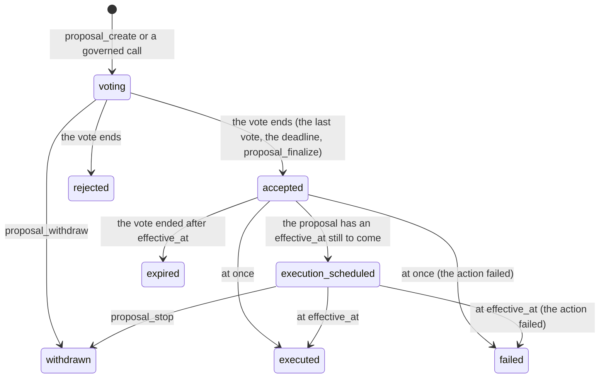

# Governance and delegation

A realm decides things in three ways: a member acts with a permission they hold, a body votes,
or someone acts for another person under a power of attorney. All three go through the same
operations; the code is [`api/proposals.py`](../../src/realm_backend/api/proposals.py),
[`api/orgs.py`](../../src/realm_backend/api/orgs.py) and
[`api/delegation.py`](../../src/realm_backend/api/delegation.py).

## Departments and policies

Every realm has a root department, `Administration`, and any number of departments under it
(`Civil Registry`, `Justice`, …). People hold **positions** (seats) in departments through
**appointments**. An active appointment gives the seat's permissions (see
[Authorization](authorization.md#where-permissions-come-from)).

Each department has an approval **policy**, set with `department_set_policy`:

```json
{"department": "Civil Registry", "m": 2, "n": 3, "quorum": 0, "veto": ["dana"]}
```

- `m` of `n`: how many yes votes the department needs, out of the `n` seats of its policy: a proposal's threshold is m/n,
  rounded down (2 of 3 is 66 666 666 in hundred-millionths), and the yes votes must reach it, which takes exactly `m` of
  them. `n` is what the threshold is a share of, whoever sits in the seats: a vacancy never makes a vote easier, and a
  direct policy (1 of 1) needs one yes however many hold seats.
- `quorum`: turnout needed, as a share of the department's voters (0 to 100 000 000; every ratio is in hundred-millionths,
  so 50 % is 50 000 000 and 0.1 % is 100 000).
- `veto`: seated members whose *no* rejects the proposal.

A policy is **direct** when `m ≤ 1`, `n ≤ 1`, there is no quorum and no veto. A department with no
policy is direct.

## Governed operations

An operation declared `governed=` names the department that governs it:

```python
@op("extension.install", governed=realm_wide)               # the root department
def extension_install(c, args): ...

@op("user.add", governed=in_charge("user.add"))             # the department named in args
def user_add(c, args): ...
```

When someone calls a governed operation:

- If the governing department's policy is **direct**, the operation runs at once (it is still
  authorized by Cedar and audited).
- Otherwise the call **does not run**. It files a proposal instead and replies
  `{"ok": true, "proposal": "P-12", "requires_vote": true}`. If the proposal passes, the exact call
  is replayed.

So a small realm can start with no policy and act directly, then add a policy to the root
department when it wants votes. Setup is a special case: during setup the founder configures the
realm directly; after `setup_launch`, configuration is governed by the root department.

## The life of a proposal



| Step | Operation | Notes |
|---|---|---|
| File | `proposal_create` | `title`, `description`, `department` (default: the realm), optional `action` `{op, args}`. Voting opens at once. |
| Vote | `proposal_vote` | `choice`: `yes`, `no` or `abstain`. Voting again replaces your vote. Delegable. |
| Close | `proposal_finalize` | Closes a vote that has ended and records it accepted or rejected; an accepted action runs at once, unless its `effective_at` is ahead. |
| Act | `proposal_execute` | Replays the action of an accepted proposal that has not run, once, with origin `replay`, as the proposer (the grantor, for a call made under power of attorney). A department's proposal may only carry actions that department, or one under it, governs; a realm-wide proposal may carry any. A proposal made from a delegate's governed call runs unless its grant was revoked or replaced, and only if the grant could still make that call (see [Delegation](#delegation-power-of-attorney)). |

**A proposal can state when it takes effect.** `proposal_create` takes an optional `effective_at` (whole seconds, UTC; a time in the past is refused).
Once the proposal is accepted its action runs at that time instead of at the vote, and the proposal is
`execution_scheduled` while it waits. The wait is a one-step task of the realm's task scheduler
(`task_list` shows it), which is armed again after an upgrade. The time never moves. If the time proves wrong, another
proposal carries `proposal_stop` as its action and the scheduled proposal ends `withdrawn`; a new proposal then sets
the right time. A vote ends at its deadline, or earlier at the deciding vote or the moment every eligible member has
voted, and after that no vote is accepted or replaced. The time it is closed does not change that: a timer that fires
late, an upgrade or a `proposal_finalize` days after the deadline do not expire a proposal. A vote that ends after
`effective_at` leaves the proposal `expired` and runs nothing. A vote that ended in time but is closed after
`effective_at` is accepted and its action runs at once, by the timer, an upgrade or `proposal_finalize`. Proposals due
in the same second run in no set order.

**A proposal can link to others.** `proposal_create` takes optional `links`, at most 16 of `{kind, proposal}`: `replaces`
(this proposal takes the place of an earlier one) or `relates_to` (a plain reference, both ways), each proposal named
once. The links are fixed at creation, like the action; to change a proposal, its proposer withdraws it and files a new
one that `replaces` it. A `replaces` target must be a withdrawn proposal filed for the same member (the grantor, for a
call made under power of attorney), and a withdrawn proposal is replaced once: a second `replaces` of it is a
`Conflict`, and when the replacement is withdrawn in turn, a new proposal replaces *it*, so the first one stays
replaced by the second. The other side is readable: `proposal_get` shows the proposal that replaces this one
(`replaced_by`), and `proposal_linked_from` lists, a page at a time and oldest first, every proposal that links to it
(`replaces` there reads "replaced by"). Nothing limits how many proposals link to one.

The voting window comes from the realm's calendar (default 7 days). `governance_update` changes
it, along with the realm-wide `voting_threshold` and `voting_quorum`, in hundred-millionths, and the
realm's **casting vote**, `casting_vote`: the principal of an active member, or `""` to remove it.

**The rule of a proposal.** Every proposal stores the rule that decides it when it is filed, like its action:
`threshold`, `quorum`, `threshold_of` (`cast`, the yes and no votes cast, or `eligible`, all the eligible voters) and
`casting_vote`, and `proposal_create` also takes `kind` and `matter`, the realm's words for what it is and decides. The
default rule is the scope's own:

- realm-wide: the realm's `voting_threshold` and `voting_quorum` over the votes `cast`, and the realm's `casting_vote`
  at that moment;
- a department: m/n of its policy's `n` seats, with the policy's `quorum`, and no casting vote.

A proposer may state a stricter rule in `proposal_create`, never a weaker one (`InvalidArgument`): a higher
`threshold` or `quorum`, or `eligible` where the default is `cast`. A proposal a governed call files takes its scope's
default rule. A stricter department threshold `t` needs ceil(`t` · `n`) yes votes. The electorate is counted when the
vote opens (`tally.eligible`, for the quorum and for the end when everyone has voted), and a department's vote keeps the
policy's `n` as it was then (`tally.seats`): members who join, seats that fill and later changes to the policy do not
change what the rule is measured against.

**Who votes and how it is counted:**

| | Realm-wide proposal (root department) | Department proposal |
|---|---|---|
| Eligible voters | every active member | the head and the holders of active seats |
| Passes when | turnout ≥ the stored `quorum` and yes *exceed* the stored `threshold` of yes + no (`cast`) or of all the eligible voters (`eligible`). Under `cast`, a tie exactly at the threshold passes if the casting member is still a member and voted yes | yes *reach* the stored `threshold` of the policy's `n` seats (exactly `m` under the policy's own rule), turnout ≥ the stored `quorum` of the eligible voters, and no veto holder voted no |
| Rejected when | the rule above fails at the end of the vote | the rule above fails at the end of the vote |
| Can close early | yes, once every eligible member has voted | yes, once every eligible member has voted, or as soon as it passes and every veto holder who can still vote has voted. Only an acceptance ends it early: until the deadline, or until every eligible member has voted, a no (a veto holder's too) can be replaced, even when the threshold is out of reach |

A department cannot be deleted while it has a proposal being voted on or waiting to run. Only the root department
is realm-wide: a proposal whose department is gone has no voters and runs nothing.

A department can only hand out what its own seats hold, but that is enough to be careful with: seating someone in a
seat whose profile is `admin` makes them admin, and a department holding `role.revoke` or `user.update_status` can act
on realm admins.

## Mandates and contracts

A passed proposal can grant a **mandate**: a scoped, time-limited authority for a department to
act, for example "sign road contracts up to 200,000". `mandate_create` records it,
`contract_create` makes contracts under it (checking value, dates and that you hold a seat in the
executor department), and `mandate_revoke` stops new ones.

## Delegation (power of attorney)

A member can let someone else act for them: a person, or an AI agent.

```bash
# Alice lets her assistant vote for her for 30 days
realms local call delegation_grant '{"delegate": "<assistant principal>",
  "groups": ["vote"], "expires_in": 2592000, "label": "assistant"}'

# The assistant then signs calls for Alice
realms local call proposal_vote '{"proposal": "P-7", "choice": "yes", "on_behalf_of": "<alice>"}'
```

### Tiers and groups

Every operation has a **tier** and, mostly, a **group**. GGG states them for its operations in `ggg/delegation.json`
(generated into `ggg_delegation.py`); the operations Realms GOS adds are in `core/poa.py` (`OWN`).

| Tier | Under a grant |
|---|---|
| `direct` | Runs at once as the member, and the member is told afterwards. |
| `confirm` | Asks the member each time: a delegate only prepares it, and the member approves it ([Pending actions](#pending-actions-the-members-tap)). |
| `member`, `founder` | The member's own act (`delegation_revoke_all`), or the founder's (`setup_launch`). Never under a grant. |
| `none` | Needs no power of attorney: public reads, calls between canisters, the host's steps. |

A few `direct` operations ask each time when their arguments say so (`proposal_create` with an action, an invite that
carries a profile or a seat, a trust-policy step, and others): `confirm_if` names the condition (`CONDITIONS` in
`core/poa.py`).

A grant names **groups**, plain-language sets of operations, such as `vote`, `propose` or `see`, or `*` for everything:
every group, those the member gains later included, and every operation a later release adds, but never a `member` or
`founder` operation. A grant names groups or permissions, never both.

- `delegable_operations` returns the groups the caller can grant (also `delegation_groups`, paged, and GGG's
  `ggg_delegation_groups`): each with its label, summary, risk and longest duration, and the operations in it the
  caller holds, with their tiers. A group is listed when the caller holds the permission of one of its enabled
  operations. It comes with `operations`, the operations a grant that names permissions covers.
- A grant of a group lasts at most the group's `longest`: a year, except `money` and `admin` (90 days) and `setup`
  (30 days). A grant naming several groups lasts at most the shortest; `*` lasts at most 90 days, and each group's own
  longest still applies under it. Nothing lasts more than a year.
- The limits are read when a call is made, not only when the grant is: a stricter limit binds a grant made before it.
- **The rollout.** `ENABLED` in `core/poa.py` lists the operations a grant by groups can reach in this release. The
  classification arrives whole, the code in phases, so an operation that is not enabled is refused whatever its
  tier. This release enables the 24 operations that were delegable once phase 0 had closed its holes, and the five
  that phase 0 removed, which come back as pending actions: `payment_account_add`, `payment_account_remove`,
  `identity_submit`, `self_change_quarter` and `federal_vote_propose` (and `proposal_create` with an action), with
  `action_get` and `action_list`.
- **Grants made before groups** name permissions (`operations`) and keep covering exactly those 24 operations (`LEGACY`),
  with the behaviour they had then: a proposal with an action stays refused, and payout accounts, identity proofs,
  quarter moves and federal votes stay refused. A later release never widens them. `attribute_list` is not among them: a
  grant of `self.data_view` was consented as profile, notifications and invoices, and attributes are personal data.

### Rules for a delegate

- `operations` lists **permissions**, not operation names, in a grant made the old way. A grant lasts at most a year.
- If the delegate is a registered user, the grant is **pending** until they `delegation_accept` it.
  Any other delegate (such as an AI agent's principal) gets it at once.
- Either side ends it with `delegation_revoke`. `delegation_revoke_all` ends every pending or active grant the member
  gave, a page at a time, and is the member's own act: it is refused under any grant.
- A delegate can ask instead: `delegation_request` (open for one hour, at most 10 open requests
  per person), answered with `delegation_request_decide`, which can only narrow the request: fewer groups, an earlier
  expiry.
- Payout accounts, identity proofs, moving to another quarter, federal votes and a proposal that carries an action are
  never done directly under a grant: under a grant by groups they are prepared, and wait for the member's tap
  ([below](#pending-actions-the-members-tap)). Under a grant made before groups they stay refused. Power of attorney
  itself, tasks, keys, the shell and extension calls are not done directly under a grant either, and a later release
  switches them on.
- A proposal a delegate files with `proposal_create` is a motion: it carries no action. With an action it is a pending
  action (under a grant by groups) or refused (under an old grant).
- A grant to the realm's own principal is refused: the effects of a codex's chapters act as the realm, and would act
  for the member.
- A delegate's governed call (a transfer from a fund, say) is always filed as a proposal, even where the
  department decides directly. The proposal records the grant it was filed under. When it is carried, the call runs
  unless that grant was revoked or replaced, and only if the grant could still make the call: its scope, its limits (the
  grant's longest duration is measured at the filing, not at the vote), the member's permissions and standing are
  checked again. A grant that has merely expired does not stop it, because a
  vote can outlast the grant; after the grant has expired, the member stops such a proposal by withdrawing it (or
  voting no). Otherwise the proposal ends `failed`, with the reason.
- A delegate never votes on a proposal it filed or prepared, whichever grantor it votes for: a delegate that holds grants
  from two members and filed for one votes on it for neither. And no delegate of a member votes
  on a proposal that a delegate of the same member filed, or prepared as a pending action the member approved
  (I-ID-13), whoever it was and whatever the status of that grant now. The member votes on it as usual, and a delegate
  of another member may. A delegate withdraws only the proposals it filed under its grant.
- A delegate reads the member's own notifications, not the inboxes of the offices where the member holds a seat.

### What the member is told

- After a delegate's update succeeds, the member gets a notification with topic `poa`: "‹name› did ‹what›", linked
  to the proposal it concerns or else to the Power of attorney page. ‹name› is the grant's label, or else the
  delegate's principal. A delegate's acts within an hour share one notice (`Delegation.notice` and `notice_acts`): it
  keeps a count and the last ten acts, and is unread again each time. Reads send nothing, and marking notices read
  leaves none.
- A delegate never marks a `poa` notice read, nor a `poa.confirm` one: by id it is refused, and with `all` it is left
  unread.
- The audit `Event` of a delegated act names the grant it ran under (`Event.grant`, indexed). `delegation_activity`
  pages the events of one grant, newest first, to its grantor and to its delegate, who needs no permission of its own
  for that grant (an AI connection has none). The audit log keeps its last 2,000 events, so the reply says how far
  back it reaches (`since`); the `poa` notices are the lasting record.

### Pending actions: the member's tap

A call in its confirm form (a `confirm` operation, or a `direct` one whose condition holds) is never done under a grant.
The delegate prepares it, and only the member's own approval runs it. The code is `core/pending.py`, the operations
`api/actions.py`, the record `PendingAction` (`AC-<n>`).

1. **Filing.** A delegate's call with `on_behalf_of` reaches `dispatch`, which sees that it asks the member each time
   and files it instead of running it: through `run` with the operation's own name, or through `call_for` (GGG's
   `ggg_call_for`, which also takes a `note`). The grant must be active and cover the operation's group, the arguments
   must pass the operation's own checks, and the member, acting for themselves, must be allowed the call now. At most 10
   actions wait between one member and one delegate, and the arguments are at most 32 KB of canonical JSON. The reply is
   `{pending, approve_link, expires_at}`, the member gets a notice (topic `poa.confirm`, linked to
   `/delegations/confirm/AC-<n>`), and the audit log records the filing: `user` the member, `by` the delegate, the
   result `{pending: id}` and the grant. A call that asks the member each time, made through the operation's own typed
   method (not through `call_for`) with `on_behalf_of`, is refused, saying to use `ggg_call_for`, because the method's
   reply has no place for a pending action.
2. **The record.** It holds the exact `method` and `args`, never edited. A card also carries `title`, the operation's
   plain name ("Add a payout account"), which the realm writes beside the operation (`title=`). `summary` (a label and a value per line) and
   `risk` are the realm's own words, written from the stored arguments and the operation's `summary` hook, never from
   text the delegate supplies: each argument appears under its own lower-case name, the lines the realm adds start with
   a capital, and the delegate's text inside them is quoted. Every card ends its realm lines with "What happens next":
   "Runs at once when you approve", or the proposal that approving files when a department governs the call. Only
   `note` is the delegate's, and a client shows it apart.
   `hash` is the sha256 (the canister's native one) of the canonical JSON of the realm's canister id, the id, the call,
   the grantor, the delegate, the grant and `expires_at`. It lasts 24 hours.
3. **Approving.** `action_approve {action, hash}` takes nothing else. It is the member's own act: refused under a grant
   (`on_behalf_of`), for any caller but the grantor, from a task, extension, codex, shell or replay, and inside
   `call_for`. It succeeds only if the hash matches, the status is `pending`, the time has not passed and the grant is
   still active and covers the operation. The realm then sets `approving` and `decided_at` before the call awaits
   another canister, so a second approval meets it; runs the stored call through `dispatch` as the member with origin
   `confirmed` (checked like `user`: permission, guardrails, parties, banned status, now); and stores the reply as
   `result`, without secrets (they are in the approval's own reply alone), as `done` or `failed`. A governed call goes
   as the member's own would: at once where the department decides directly, else as the member's own proposal with
   `prepared_by` the delegate. The audit `Event` has `user` and `by` the member, origin `confirmed`, `prepared_by` and
   `grant`. An action left `approving` after a trap reads `failed` after 10 minutes and is never retried.
4. **Declining and withdrawing.** The member declines (`action_decline`); the delegate withdraws its own
   (`action_withdraw`).
5. **Reads.** A read in its confirm form is approved, not run: the action is `approved` and stores nothing. The delegate
   collects it once with `action_collect`, before it lapses and while the grant covers it: the realm runs the read as the
   member then and returns the reply. The audit log records `{collected: id}`, never the reply.
6. **Lazy states.** Nothing sweeps. An action reads `expired` once its day has passed and `void` once its grant was
   revoked, replaced, has ended or no longer covers the operation, whenever it is read, listed, approved or counted
   against the limit of 10.

### The member's pages

The confirm and Authorize pages share one frame (`ConsentShell`): they do nothing inside another site's frame (the same
parents as `frame-ancestors`) and show nothing until the member is signed in. The cards of "Waiting for you" on
`/delegations` are the same `ActionCard` as the confirm page's, but the page around them also lists grants, so it is not
refused as a whole: each card checks the frame itself and, inside another site's frame, shows no Approve or Decline.

- **`/delegations/confirm/<id>`** shows one action from `action_get` and nothing else the link carries. The heading
  is the operation's `title`; the delegate's arguments sit apart from the realm's own lines (a one-word lower-case
  label is an argument), and `note` is shown as the delegate's words, with its control and bidirectional characters
  written out as escapes. Approve sends `{action, hash}` of the card shown; nothing on the page can be edited. An expired, void, declined, withdrawn, done or failed action shows its state with no buttons, and the
  delegate who opens the link reads the action in words written for them ("You asked ‹member› to approve one action",
  "‹member› can decide until …") but cannot decide it.
- **`/delegations/authorize/<request>`** lists the groups a request asks for (label, what it allows, its risk, a badge
  where some of it asks each time, all from `delegable_operations`). The member can untick groups and shorten the
  expiry, never widen either. "Everything" appears only when the request asks for it and is never ticked until the
  member ticks it. A request that names permissions (an older client) shows them as before.
- **`/delegations`** lists, top to bottom: what waits for the member (pending actions as the same cards, and open
  requests with a link to review), their grants (groups as chips, Activity, Revoke, Revoke all), the activity of a grant
  (from `delegation_activity`, saying how far back the audit log reaches), the grants to them, and the manual grant by
  groups (30 days suggested).

When a `run` replies `{pending, approve_link}` the realm client (`$lib/realm`) shows one notice, "Sent to the member for
approval", with the link: a human delegate is told in one place, whichever page made the call. The notice links only to
a path under `/delegations/confirm/`; any other `approve_link` is ignored.

The guardrails make delegation safe by construction: a delegate can only do what its grant covers, only on `direct`
operations, never on `signing` ones, and never with `all`. The audit `Event` records both the grantor (`user`) and the
signer (`by`). `codex_status` reports `agents` and `delegable` empty: no signing permission is open to an agent or to
a delegate, whatever the codex says.

## Agents

An **agent** is a principal with an agent appointment (`representative_add ... agent=True`), always
under a human supervisor who holds a seat. Agents can hold permissions and act, but the guardrails
forbid them every `signing` operation: judgments, licences, credentials, freezes and the like
must be made by an accountable human.
