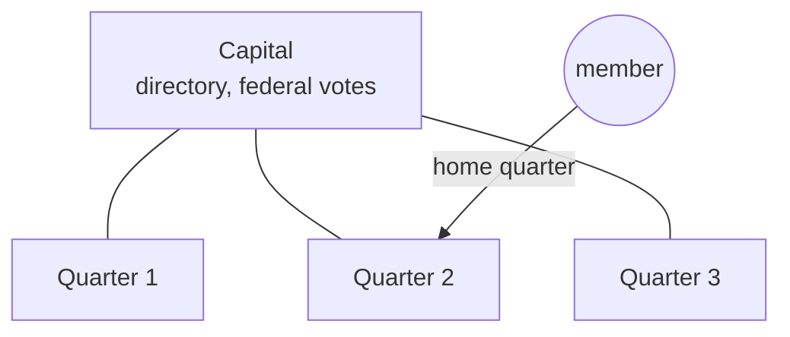

# Quarters and federation

One canister holds a few thousand members comfortably. A larger realm becomes a **federation**:
a **capital** canister plus **quarters**, each a full realm canister running the same code. The
code is [`api/quarters.py`](../../src/realm_backend/api/quarters.py) and
[`api/federation.py`](../../src/realm_backend/api/federation.py); the specification is GGG §10
([spec](../ggg/spec.md)), and the original design is in [quarters-design.md](../project/quarters-design.md).



## Key facts

| | |
|---|---|
| Capacity | 2,000 members per quarter (10 on test networks). A new quarter is wanted at 90%. |
| Size | At most 500 quarters. |
| Quarter status | `setup` → `active` ⇄ `suspended`; `active` → `splitting`, `merging` → `active` |
| Membership | Each member belongs to one **home quarter**. Elsewhere they are a guest with read-only rights. |
| Trust | A quarter accepts federation calls only from canisters it has registered (the capital holds `quarter.sync` on it, and the reverse). |

## Building a federation

Every quarter operation that changes the federation is governed realm-wide.

```bash
# on the capital: add a quarter canister
realms realm call capital quarter_register '{"quarter": "<canister id>", "name": "North"}'

# on the new quarter: accept the capital
realms realm call north quarter_join_federation '{"capital": "<capital canister id>"}'

# activate it, set capacity and the join mode
realms realm call capital quarter_configure '{"quarter": "<canister id>", "status": "active"}'
```

`quarter_deregister` removes a quarter; `quarter_secede` lets a quarter leave and run on its own.

## Joining and moving

- `join_targets` (public) suggests the least-populated active quarter. The capital takes joins
  only until it has quarters. If the codex has an `assign_quarter` hook, the hook may choose
  instead (for example, by region). A layered codex's `compute_realm_join` may instead keep neighbours
  together: given the joiner's optional `home_zone` and the quarters below capacity with the zones
  each holds members of, it may choose the quarter that holds the joiner's zone.
- `quarter_directory` (public) lists the capital and every quarter with its population and codex. The
  districts each quarter's members live in, with how many, are reported in `quarter_sync` for the
  capital's placement alone: a small count singles out a person, so no reply carries one.
- `scale_status` (public) compares populations with the capacity.
- `self_change_quarter` moves your membership to another quarter. The old quarter keeps a signed
  `Forward` record and makes you a guest there.

The UI calls the active quarter with `quarter.read` / `quarter.run` from
[`realm.ts`](../../src/realm_frontend/src/lib/realm.ts), and the capital with `read` / `run`.

## Keeping in sync

`quarter_sync`, called on a quarter, reports its population, codex and the zones its members live in
to the capital and takes the capital's directory back, with the zones the realm defines: its codex
defines its districts on the capital alone, and a quarter defines the same by id (a repeat redefines in
place; a zone the quarter defined itself stays). The capital flags a quarter whose codex **drifts** from its own.
`federation_message` carries other messages between registered canisters (for example
`user.arrive` when a member moves).

A call between the capital and a quarter carries the checksum of the codex its sender runs, and the
receiver records it. A new layered codex reaches the quarters at one switch time: the capital announces
it, each quarter stages it from the capital, and the capital flags a quarter that is not ready by then as
non-compliant ([the layered codex, §9.5](../codices/layered-codex.md#95-updating-a-realms-own-quarters)).

A realm can also take legislation from other realms it chooses by vote, its **sync sources**, with
no parent realm. Those links, the releases a sync source publishes, how a follower installs them, and
how a new codex reaches a realm's own quarters at one switch time are in
[The layered codex](../codices/layered-codex.md) (not built yet).

### What a sync carries

A quarter syncs when it starts and then every `sync_every` seconds, an hour at least. Every quarter of a federation
does, so what a sync costs is paid in each of them every hour, and what it carries must not grow with the size of the
federation when nothing has changed.

The capital notes each change a quarter takes from it in a log of the last 256 (`SyncChange`, `core/sync_log.py`, a ring
of rows that are written over, never deleted): a quarter's row of the directory (it joined, left, was configured, reported
another codex or was judged differently, or its population moved by a hundredth of what a quarter takes, 20 members at the
default), a zone the realm defines, the synced settings, the sweep rules. What every quarter does every hour is no change:
its `last_sync` and a population that moved by less. A quarter's report carries the **cursor** it holds, `have`: the number
of the last change it took and when that one was made. The answer carries what came after it:

| Part of the answer | When it carries something |
|---|---|
| `directory` | the capital's own row, always; the rows of the quarters that changed. `removed` names those that left |
| `zones` | the zones defined or changed |
| `settings`, `sweep` | only after a change of a synced setting or of the sweep rules |
| `codex`, `index`, `sync_every`, `official_timezone`, `rev` | always: they are a few bytes, and `rev` is the cursor to present next time |

A quarter with no cursor, one whose cursor is ahead of the log or names a change that is not the log's (the capital was
restored from a snapshot), one further behind than the log keeps (256 changes), and one whose cursor was read before the
capital last **started** is answered with everything, as every quarter always was. The cursor names the epoch of the log,
a time the capital sets at every install and upgrade: an upgrade may serve what it did not serve, and a capital rolled
back to a release that has no log changes what it serves without a note, so that its log reads, on the next upgrade, as
it did when the quarter last synced. Each quarter of a capital that starts again takes everything once, and the changes
after. So does every quarter in its first sync after it starts: the cursor is presented only by a heap that has already
synced, so an upgrade is followed by a full sync. A quarter keeps the cursor only when it has taken the whole answer; a
sync that failed, or could not read an image, is asked for again from the old one.

The quarter's report is cheap too. It carries the population and codex, and the **census** of the zones its members live
in only when a member moved into or out of one since the capital last took it (and in its first sync). The capital writes
a row only where a field differs, and a quarter does the same with the directory, the zones and its settings, so a sync
that changes nothing writes nothing but the quarter's `last_sync` on the capital. A report that changed nothing worth a
note (the same, or a population that moved by less than a step, or another census) leaves no audit event either: every
quarter reports every hour, and the audit log keeps only `EVENTS_KEPT` events.

What a quarter shows of another quarter is therefore as of that row's last change: its `last_sync`, not that of its last
sync (a row that carried it would change at every sync), and its population, the one the row last told the quarters (a
row that travels for another reason tells the population it has), which is within a hundredth of the capacity of the truth
(a quarter that is full to within 20 members may be offered a member), in a delta as in a full answer. The capital's own
list keeps both exact, and nothing reads the other quarters' `last_sync`.

The two ends need not be the same release. A quarter that presents no cursor, which is what the previous release does,
is answered with everything; a quarter that gets an answer without `rev` or `delta`, from a capital on the previous
release, takes it as it always did and never presents a cursor. Both stay correct and as slow as before until both
ends are upgraded, in either order.

## What the realm sets for its quarters

A realm has one face, so its quarters share some settings and keep others
([#528](https://github.com/smart-social-contracts/realms-gos/issues/528)).

| Group | Settings | Rule |
|---|---|---|
| **Identity** | the realm's name (each quarter keeps its own quarter label), logo, background image and colours (branding), manifesto, the realm's terms text, lifecycle stage | **Kept in sync from the capital** |
| **Shared foundations** | accounting currency, the languages offered | **Kept in sync from the capital** |
| **Local, with a default** | time zone, welcome message | **Copied once when a quarter joins,** then the quarter's own |
| **Not pushed as settings** | voting rules (window, threshold, quorum) | They belong in the codex |
| **Not pushed** | registration: `quarter_join_mode` is the capital's already, through `quarter_configure`, and `open_registration` is each quarter's own; capacity, the capital's through `quarter_configure`; notification settings, departments, members, treasury | Local, or the capital's already |

**Kept in sync from the capital.** The capital owns these values and a quarter cannot change them. A
realm-wide vote changes them on the capital, with the usual operations (`realm_configure`,
`realm_configure_branding`, `realm_configure_tokens`), and the capital pushes them to every quarter.
The fields are `Realm.name`, `manifesto`, `terms`, `logo_url`, `background_image_url`, `primary_color`,
`accounting_currency`, `accounting_currency_decimals`, `languages` and `status` (`SYNCED` in
[`api/quarters.py`](../../src/realm_backend/api/quarters.py)). The manifesto and the terms text are at
most 20,000 characters each: they travel whole with every push, whose record holds 65,536.
The quarter's label is not the realm's name: it is the `name` under which the capital registered the
quarter, which the quarter learns with the directory, as it learns its `index`. Only the capital can
rename a quarter's label, with `quarter_configure` and its `name`; the quarter itself cannot. A realm that joins as a quarter takes the capital's identity at its first sync, and its
former name is dropped. A quarter that secedes keeps the values it last received, and they are its
own to change from then on.

**A different currency cannot join.** Amounts are integers in units of 10**decimals, so changing a
realm's accounting currency, or only its decimals, would rescale its books. A realm whose currency code
or decimals differ from the capital's therefore cannot join as a quarter: `quarter_join_federation`
refuses, with an error that says to change the currency first, through the realm's own governance. A
realm that has not chosen a currency yet (a blank code) takes the capital's code and decimals. The join
reads the capital's public `realm_info`, which holds the currency code and decimals, the time zone and
the welcome message.

One list of synced fields drives the parts of the mechanism, which uses the capital-to-quarter channel
the federation already has (`quarter.sync`):

- **Push.** Any operation that changes a synced field on the capital triggers it: the three
  `realm_configure` operations, `setup_launch` for the stage, and any other that writes one. The
  capital first writes its own values and then sends the current values of all synced fields to every
  active quarter with `federation_message` (topic `realm.settings`), which no member or chapter can
  relay. A quarter accepts it from its capital only and writes the fields directly. The message always
  carries the whole set, so a repeated or late one does no harm.
- **Images travel as digests.** A branding image is a data URL of up to 960,000 characters, too big to
  send with every push and sync, or to keep in a message's record, and two of them with the rest of
  `realm_info` may not fit in the 2 MiB a reply to another canister may be. The push and the sync carry
  each image's sha256 instead, which the capital takes once after each change, and a quarter whose image
  differs reads that image alone from the capital's public `realm_image`. The quarter writes the other
  settings first: an image it cannot read now holds up none of them, keeps its old digest, and is read
  again at the next sync; its reply says so (`images_error`).
- **A quarter that fails does not stop the push.** The capital's relay of a `federation_message` to all
  its quarters stops at the first quarter it cannot reach: the failed call raises and the operation
  traps. The settings push instead sends each quarter a message of its own, as the messages that carry
  a codex do ([the layered codex, §9.5](../codices/layered-codex.md#95-updating-a-realms-own-quarters)),
  and records each quarter's reply, a failure included, in the `FederationMessage` of that message. A
  quarter on an older release answers `ok` to a topic it does not know and applies nothing: a reply that
  does not say what it `configured` is recorded as a `Conflict`, to upgrade the quarter. The
  capital's value stands, so one quarter cannot stop the realm's name from changing. This differs from
  setting one quarter's zone below, where the quarter is the target and its refusal fails the call.
- **Catch-up.** The capital's answer to `quarter_sync` carries the same set of values, next to the
  directory and the codex, and the quarter applies them. A quarter syncs when it starts after an
  upgrade, on a timer every `sync_every` seconds, and whenever it runs `quarter_sync` itself, so a
  quarter that missed a push, because it was down, upgrading or suspended, has the current values at
  its next sync. The answer also names the capital's time zone, `official_timezone`, which the quarter
  keeps beside its own and `realm_info` shows: the realm's official time is the capital's, and the UI shows
  a realm-wide time in it with the quarter's own time beside it when the two clocks differ. It is not a
  synced setting, so the quarter's own zone stays its own. The capital sets `sync_every` with
  `quarter_configure`, from an hour (the default) to a week, and the quarters learn it at their next sync: pushes on change already exist, so the timer only
  catches up, and each sync carries the whole directory. After an upgrade a quarter syncs within two
  minutes, at a moment its canister id sets, so that quarters upgraded together do not all call their
  capital at once. The error of a catch-up that failed stays in the quarter's `sync_state` until one
  succeeds, so a quarter stuck behind shows why.
- **Refusal.** On a quarter, `realm_configure`, `realm_configure_branding`, `realm_configure_tokens`
  and `setup_step` refuse a call that carries a synced field, with `Forbidden` naming the capital. The
  whole call is refused, before it becomes a proposal, so before any vote on the quarter. The
  operation refuses it again when it runs, because a quarter's state can change during a vote.
- **Federal votes.** A federal vote's action is replayed on the capital and, once the result reaches
  them, in every quarter. When the action changes a synced field, only the capital replays it: the
  change takes effect there and reaches the quarters by the push, and each quarter skips the replay,
  so none answers `Forbidden`.

**Local, with a default.** The time zone and the welcome message are copied once, when a quarter joins
the federation. Only a value still at its default takes the capital's (`UTC` for the zone, empty for
the welcome message): a joining realm that already chose one keeps it. After that the value is the
quarter's own, and a later change on the capital does not follow. The quarter changes it through its
own governance (`realm_configure` on the quarter). The realm may also set it for a quarter by a
realm-wide vote, with `quarter_configure` on the capital and the `quarter` it names; the capital sends
it to the quarter as it does a zone (below). A `welcome_message` with no `quarter` is refused before
any vote, like a `timezone` with none.

**Voting rules are not pushed as settings.** The voting window, threshold and quorum belong in the
codex, which reaches every quarter at one switch time
([The layered codex](../codices/layered-codex.md#95-updating-a-realms-own-quarters)). A pushed setting
would arrive at another moment and bypass the legislation.

**The stage and `setup`.** A quarter that has not launched is in `setup`, configured by its founder
without votes, and the sync does not end that: the quarter applies the other synced fields and leaves
its stage alone. A quarter's `setup_launch` takes the capital's stage instead of `alpha`, and is
refused with `Conflict` while its capital is still in `setup`, and also while the quarter has never
synced, because it does not yet know the capital's stage: it must have its first sync. From then on
the stage is kept in sync like the rest. Whenever a push or a sync changes a quarter's stage, the quarter runs its codex's
`on_stage_change` with the new stage, and `setup_launch`'s hook gets the stage the quarter took.

**What `adopt()` does for a new quarter.** When the capital builds a quarter (`quarter_add`), `adopt()`
has the new quarter join, gives it the capital's `open_registration`, registers it under the `name`
`quarter_add` was given, syncs it and launches it:

- The realm's name is not sent: it reaches the quarter by sync, and the label the quarter shows is the
  one the capital registered. A quarter refuses a synced field in `setup_step` anyway.
- `open_registration` is the starting value of a quarter the capital builds, so that the members it is
  offered to can join. Registration stays local: a realm that joins on its own keeps its own, and
  nothing follows after the build.
- The launch (`setup_launch`) comes right after the first sync, which brings the realm's name the launch
  needs, and the quarter takes the capital's stage at once.
- The quarter stays pending, and `adopt()` looks again every `ADOPT_EVERY` seconds, until the first
  sync and the launch have both succeeded, skipping the steps already done.

## Time zones in a federation

Quarters can lie in different time zones, and each is a full realm with its own `Realm.timezone`. The zone is
one of the two settings that are local, with a default (above).

- A new quarter **starts on its capital's zone,** copied once by `quarter_join_federation` when the
  joining realm is still on `UTC` (not yet chosen): the join reads the capital's public `realm_info`, and a
  capital that cannot be reached is not joined. A realm that already chose a zone keeps it. After
  that the zone is the quarter's own.
- A quarter **changes its own zone** with `realm_configure`, governed on the quarter as today.
- The realm **sets a quarter's zone** by a realm-wide vote on the capital. The capital sends it to the
  quarter over `quarter.sync` (a `federation_message` of topic `quarter.local_settings`, which only
  `quarter_configure` sends and no member or chapter can relay) before it writes anything else, and the
  quarter applies it; a quarter that refuses it or cannot be reached fails the call, and nothing changes.
  A malformed name, or a `timezone` with no `quarter`, is refused before any vote.

```bash
realms realm call capital quarter_configure '{"quarter": "<canister id>", "timezone": "Asia/Tokyo"}'
```

The codex never sets a zone. Two clocks have separate jobs:

| Clock | Zone | Used for |
|---|---|---|
| The realm's official time | the capital's | realm-wide votes, their deadlines and working days; a realm-wide `effective_at` as people see it; the official journal |
| A quarter's local time | the quarter's | its own departments' deadlines and working days; the local time its members see |

Realm-wide counts are made on the capital. A federal vote's deadline is set there once, as an instant,
and every quarter's leg keeps it. A quarter never counts on the capital's clock, and its own votes, its
root department's included, use its own zone. The UI shows a realm-wide time in the official time, with
the quarter's local time beside it when they differ. The journal on a quarter issues nothing and shows
the capital's.

An `effective_at` is an exact UTC instant, so a codex switch at that time happens at the same moment
in every quarter. The rules are in [The layered codex](../codices/layered-codex.md#45-the-self-api-at-least).

## Federal votes

Some decisions belong to the whole federation. `federal_vote_propose` opens a vote on an action
`{op, args}`; every active quarter holds a local vote, and the capital combines the results under
the federation's **rule** (set with `quarter_configure`):

| Rule field | Values | Default |
|---|---|---|
| `kind` | `majority_of_quarters` (each quarter's result counts once) or `majority_of_members` (votes are pooled) | `majority_of_quarters` |
| `threshold` | share that must be exceeded, in hundred-millionths (100 % is 100000000) | 50000000 |
| `absent` | what a quarter that did not report means: `wait`, `no` or `ignore` | `wait` |

`federal_vote_finalize` settles a quarter's leg and reports it; on the capital, it decides the vote
and runs the action if it passed. `federal_vote_cancel` withdraws an open vote everywhere.
