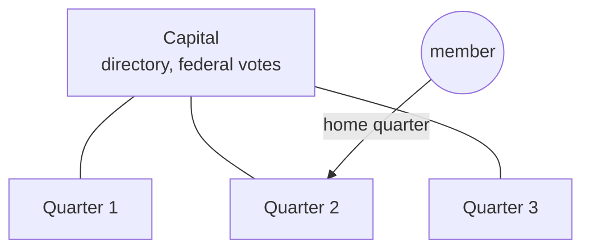

# Quarters and federation

One canister holds a few thousand members comfortably. A larger realm becomes a **federation**:
a **capital** canister plus **quarters**, each a full realm canister running the same code. The
code is [`api/quarters.py`](../../src/realm_backend/api/quarters.py) and
[`api/federation.py`](../../src/realm_backend/api/federation.py); the specification is GGG §10
([spec](../ggg/spec.md)), and the original design is in [quarters-design.md](../project/quarters-design.md).



## Key facts

| | |
|---|---|
| Capacity | 2,000 members per quarter (10 on test networks). A new quarter is wanted at 90%. |
| Size | At most 500 quarters. |
| Quarter status | `setup` → `active` ⇄ `suspended`; `active` → `splitting`, `merging` → `active` |
| Membership | Each member belongs to one **home quarter**. Elsewhere they are a guest with read-only rights. |
| Trust | A quarter accepts federation calls only from canisters it has registered (the capital holds `quarter.sync` on it, and the reverse). |

## Building a federation

Every quarter operation that changes the federation is governed realm-wide.

```bash
# on the capital: add a quarter canister
realms realm call capital quarter_register '{"quarter": "<canister id>", "name": "North"}'

# on the new quarter: accept the capital
realms realm call north quarter_join_federation '{"capital": "<capital canister id>"}'

# activate it, set capacity and the join mode
realms realm call capital quarter_configure '{"quarter": "<canister id>", "status": "active"}'
```

`quarter_deregister` removes a quarter; `quarter_secede` lets a quarter leave and run on its own.

## Joining and moving

- `join_targets` (public) suggests the least-populated active quarter. The capital takes joins
  only until it has quarters. If the codex has an `assign_quarter` hook, the hook may choose
  instead (for example, by region).
- `quarter_directory` (public) lists the capital and every quarter with its population and codex.
- `scale_status` (public) compares populations with the capacity.
- `self_change_quarter` moves your membership to another quarter. The old quarter keeps a signed
  `Forward` record and makes you a guest there.

The UI calls the active quarter with `quarter.read` / `quarter.run` from
[`realm.ts`](../../src/realm_frontend/src/lib/realm.ts), and the capital with `read` / `run`.

## Keeping in sync

`quarter_sync`, called on a quarter, reports its population and codex to the capital and takes the
capital's directory back. The capital flags a quarter whose codex **drifts** from its own.
`federation_message` carries other messages between registered canisters (for example
`user.arrive` when a member moves).

## Federal votes

Some decisions belong to the whole federation. `federal_vote_propose` opens a vote on an action
`{op, args}`; every active quarter holds a local vote, and the capital combines the results under
the federation's **rule** (set with `quarter_configure`):

| Rule field | Values | Default |
|---|---|---|
| `kind` | `majority_of_quarters` (each quarter's result counts once) or `majority_of_members` (votes are pooled) | `majority_of_quarters` |
| `threshold` | percent that must be exceeded | 50 |
| `absent` | what a quarter that did not report means: `wait`, `no` or `ignore` | `wait` |

`federal_vote_finalize` settles a quarter's leg and reports it; on the capital, it decides the vote
and runs the action if it passed. `federal_vote_cancel` withdraws an open vote everywhere.
