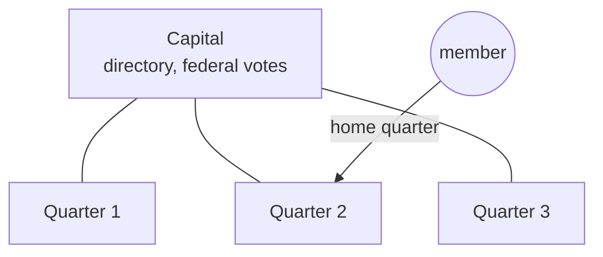

# Quarters and federation

One canister holds a few thousand members comfortably. A larger realm becomes a **federation**:
a **capital** canister plus **quarters**, each a full realm canister running the same code. The
code is [`api/quarters.py`](../../src/realm_backend/api/quarters.py) and
[`api/federation.py`](../../src/realm_backend/api/federation.py); the specification is GGG §10
([spec](../ggg/spec.md)), and the original design is in [quarters-design.md](../project/quarters-design.md).



## Key facts

| | |
|---|---|
| Capacity | 2,000 members per quarter (10 on test networks). A new quarter is wanted at 90%. |
| Size | At most 500 quarters. |
| Quarter status | `setup` → `active` ⇄ `suspended`; `active` → `splitting`, `merging` → `active` |
| Membership | Each member belongs to one **home quarter**. Elsewhere they are a guest with read-only rights. |
| Trust | A quarter accepts federation calls only from canisters it has registered (the capital holds `quarter.sync` on it, and the reverse). |

## Building a federation

Every quarter operation that changes the federation is governed realm-wide.

```bash
# on the capital: add a quarter canister
realms realm call capital quarter_register '{"quarter": "<canister id>", "name": "North"}'

# on the new quarter: accept the capital
realms realm call north quarter_join_federation '{"capital": "<capital canister id>"}'

# activate it, set capacity and the join mode
realms realm call capital quarter_configure '{"quarter": "<canister id>", "status": "active"}'
```

`quarter_deregister` removes a quarter; `quarter_secede` lets a quarter leave and run on its own.

## Joining and moving

- `join_targets` (public) suggests the least-populated active quarter. The capital takes joins
  only until it has quarters. If the codex has an `assign_quarter` hook, the hook may choose
  instead (for example, by region).
- `quarter_directory` (public) lists the capital and every quarter with its population and codex.
- `scale_status` (public) compares populations with the capacity.
- `self_change_quarter` moves your membership to another quarter. The old quarter keeps a signed
  `Forward` record and makes you a guest there.

The UI calls the active quarter with `quarter.read` / `quarter.run` from
[`realm.ts`](../../src/realm_frontend/src/lib/realm.ts), and the capital with `read` / `run`.

## Keeping in sync

`quarter_sync`, called on a quarter, reports its population and codex to the capital and takes the
capital's directory back. The capital flags a quarter whose codex **drifts** from its own.
`federation_message` carries other messages between registered canisters (for example
`user.arrive` when a member moves).

A realm can also take legislation from other realms it chooses by vote, its **sync sources**, with
no parent realm. Those links, the releases a sync source publishes, how a follower installs them, and
how a new codex reaches a realm's own quarters at one switch time are in
[The layered codex](../codices/layered-codex.md) (not built yet).

## What the realm sets for its quarters

A realm has one face, so its quarters share some settings and keep others (not built yet:
[#528](https://github.com/smart-social-contracts/realms-gos/issues/528)).

| Group | Settings | Rule |
|---|---|---|
| **Identity** | the realm's name (each quarter keeps its own quarter label), logo and colours, manifesto, the realm's terms text, lifecycle stage | **Kept in sync from the capital** |
| **Shared foundations** | accounting currency, the languages offered | **Kept in sync from the capital** |
| **Local, with a default** | time zone, welcome message | **Copied once when a quarter joins,** then the quarter's own |
| **Not pushed as settings** | voting rules (window, threshold, quorum) | They belong in the codex |
| **Not pushed** | registration (`quarter_join_mode`) and capacity, which are the capital's already through `quarter_configure`; notification settings, departments, members, treasury | Local |

**Kept in sync from the capital.** The capital owns these values and a quarter cannot change them. A
realm-wide vote changes them on the capital, with the same operations as today (`realm_configure`,
`realm_configure_branding`, `realm_configure_tokens`), and the capital pushes them to every quarter.
The quarter's label is not the realm's name: it is the `name` under which the capital registered the
quarter, which the quarter learns with the directory, as it learns its `index`. A realm that joins as
a quarter takes the capital's identity at its first sync, and its former name is not kept as its label
unless the capital registers it under that name. A quarter that secedes keeps the values it last
received, and they are its own to change from then on.

One list of synced fields drives the three parts of the mechanism, which uses the capital-to-quarter
channel the federation already has (`quarter.sync`):

- **Push.** When a call changes a synced field, the capital first writes its own values and then sends
  the current values of all synced fields to every active quarter with `federation_message` (topic
  `realm.settings`). A quarter accepts it from its capital only and writes the fields directly. The
  message always carries the whole set, so a repeated or late one does no harm.
- **A quarter that fails does not undo the change.** If a quarter is unreachable or refuses, the
  capital's value stands and the push goes on to the other quarters; each reply is recorded in the
  `FederationMessage`, as for any message to the quarters. Otherwise one quarter could stop the realm's
  name from changing. This differs from setting one quarter's zone below, where the quarter is the
  target and its refusal fails the call.
- **Catch-up.** The capital's answer to `quarter_sync` carries the same set of values, next to the
  directory and the codex, and the quarter applies them. A quarter runs `quarter_sync` on a timer and
  when it starts after an upgrade (today it runs by hand, and once from `adopt()`), so a quarter that
  missed a push, because it was down, upgrading or suspended, has the current values at its next sync.
- **Refusal.** On a quarter, `realm_configure`, `realm_configure_branding`, `realm_configure_tokens`
  and `setup_step` refuse a call that carries a synced field, with `Forbidden` naming the capital. The
  whole call is refused, before it becomes a proposal, so before any vote on the quarter.

**Local, with a default.** The time zone and the welcome message are copied once, when a quarter joins
the federation. Only a value still at its default takes the capital's (`UTC` for the zone, empty for
the welcome message): a joining realm that already chose one keeps it. After that the value is the
quarter's own, and a later change on the capital does not follow. The quarter changes it through its
own governance (`realm_configure` on the quarter). The realm may also set it for a quarter by a
realm-wide vote, with `quarter_configure` on the capital and the `quarter` it names; the capital sends
it to the quarter as it does a zone (below). A `welcome_message` with no `quarter` is refused before
any vote, like a `timezone` with none.

**Voting rules are not pushed as settings.** The voting window, threshold and quorum belong in the
codex, which reaches every quarter at one switch time
([The layered codex](../codices/layered-codex.md#95-updating-a-realms-own-quarters)). A pushed setting
would arrive at another moment and bypass the legislation.

**What `adopt()` copies today.** When the capital builds a quarter (`quarter_add`), `adopt()` sets up
the new quarter with the quarter's `name` and the capital's `open_registration`. Against the table:

- `name`: this stops. The realm's name reaches the quarter by sync, and the label the quarter shows is
  the one the capital registered. A quarter refuses a synced field in `setup_step` anyway.
- `open_registration`: this stays, as the starting value of a quarter the capital builds, so that the
  members it is offered to can join. Registration stays local: a realm that joins on its own keeps its
  own, and nothing follows after the build.

Open: a quarter still in `setup` is configured by its founder, without votes, and a synced stage of
`alpha` or later would end that. How a quarter in `setup` takes the capital's stage (for example, at
its own launch) is settled before the stage sync is built.

## Time zones in a federation

Quarters can lie in different time zones, and each is a full realm with its own `Realm.timezone`
(not built yet: [#528](https://github.com/smart-social-contracts/realms-gos/issues/528)). The zone is
one of the two settings that are local, with a default (above).

- A new quarter **starts on its capital's zone,** copied once by `quarter_join_federation` when the
  joining realm is still on `UTC` (not yet chosen). A realm that already chose a zone keeps it. After
  that the zone is the quarter's own.
- A quarter **changes its own zone** with `realm_configure`, governed on the quarter as today.
- The realm **sets a quarter's zone** by a realm-wide vote on the capital. The capital sends it to the
  quarter over `quarter.sync`, and the quarter applies it. A malformed name, or a `timezone` with no
  `quarter`, is refused before any vote.

```bash
realms realm call capital quarter_configure '{"quarter": "<canister id>", "timezone": "Asia/Tokyo"}'
```

The codex never sets a zone. Two clocks have separate jobs:

| Clock | Zone | Used for |
|---|---|---|
| The realm's official time | the capital's | realm-wide votes, their deadlines and working days; a realm-wide `effective_at` as people see it; the official journal |
| A quarter's local time | the quarter's | its own departments' deadlines and working days; the local time its members see |

Realm-wide counts are made on the capital. A federal vote's deadline is set there once, as an instant,
and every quarter's leg keeps it. A quarter never counts on the capital's clock, and its own votes, its
root department's included, use its own zone. The UI shows a realm-wide time in the official time, with
the quarter's local time beside it when they differ. The journal on a quarter issues nothing and shows
the capital's.

An `effective_at` is an exact UTC instant, so a codex switch at that time happens at the same moment
in every quarter. The rules are in [The layered codex](../codices/layered-codex.md#45-the-self-api-at-least).

## Federal votes

Some decisions belong to the whole federation. `federal_vote_propose` opens a vote on an action
`{op, args}`; every active quarter holds a local vote, and the capital combines the results under
the federation's **rule** (set with `quarter_configure`):

| Rule field | Values | Default |
|---|---|---|
| `kind` | `majority_of_quarters` (each quarter's result counts once) or `majority_of_members` (votes are pooled) | `majority_of_quarters` |
| `threshold` | share that must be exceeded, in hundred-millionths (100 % is 100000000) | 50000000 |
| `absent` | what a quarter that did not report means: `wait`, `no` or `ignore` | `wait` |

`federal_vote_finalize` settles a quarter's leg and reports it; on the capital, it decides the vote
and runs the action if it passed. `federal_vote_cancel` withdraws an open vote everywhere.
