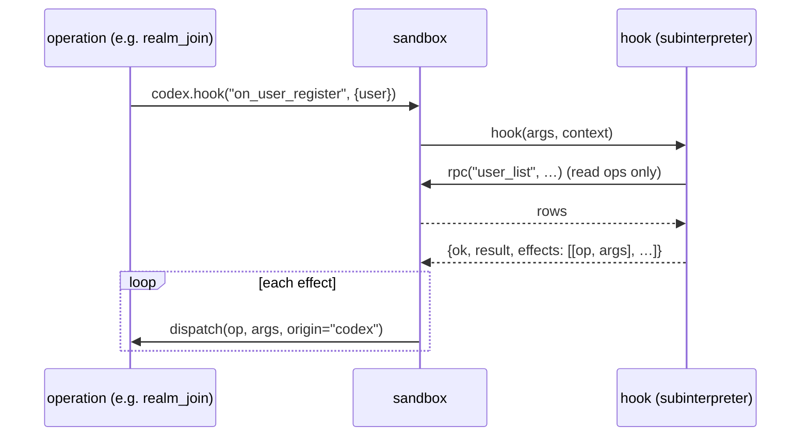

# Sandboxing

A realm runs two kinds of third-party code: **codex hooks** (the realm's laws) and **extension
backends** (features). Neither runs in the realm's own interpreter. Each call starts a fresh
Python **subinterpreter**, gives it a tiny API, meters it, and throws it away.

Extension **frontends** are contained separately, in the browser (see the
[end of this page](#extension-frontends)).

The code is [`core/sandbox.py`](../../src/realm_backend/core/sandbox.py), about 110 lines.

## What the sandbox guarantees

| Guarantee | How |
|---|---|
| No access to realm data | The subinterpreter has its own modules and globals. It never sees the database, `ggg` or `core`. |
| Only declared operations | The only way out is `rpc(action, **kw)`, and the host passes an allow-list of actions (at most 32). |
| Bounded cost | A budget of 10,000,000 bytecode instructions per call. Metering counts instructions, not time, so every replica gets the same result. |
| Only plain data crosses | Arguments and results go through `json.loads(json.dumps(...))`. No objects, functions or references leak either way. |
| Only approved code runs | The code's hash is approved just before the spawn and revoked right after. |
| No state between calls | The subinterpreter is closed after the call. |

## One call, step by step

```python
def execute(source, fn, kwargs, rpc, allowed=()):
    text = LOADER + source                       # LOADER installs ggg_sdk first
    digest = _basilisk_sandbox.sha256(text)
    _basilisk_sandbox.approve_hash(digest)
    handle = _basilisk_sandbox.spawn_subinterpreter(text, digest, "", tuple(allowed), handler, BUDGET)
    out = _basilisk_sandbox.call_in_subinterpreter(handle, fn, plain(kwargs))
    _basilisk_sandbox.close_subinterpreter(handle)
    _basilisk_sandbox.revoke_hash(digest)
    return plain(out)
```

`_basilisk_sandbox` is a module built into the
[Basilisk](https://github.com/smart-social-contracts/basilisk) runtime. In unit tests it does not
exist, and `local()` runs the same code in a fresh namespace with the same `ggg_sdk` and `rpc`, so
tests exercise the real hook code.

## Codex hooks

A codex hook does not change the realm directly. It **reads** and **returns effects**:



1. The realm gathers the **context**: the codex's configuration (its manifest with the realm's
   overrides), `now`, and a few realm fields (name, status, currency, is it a capital…).
2. The hook runs. It may call the **read** operations it declared, through `realm.call(...)`.
3. It returns **effects**: a list of `[operation, args]` to apply.
4. After the subinterpreter is gone, the realm applies each effect through `dispatch`, with origin
   `codex` and the realm as signer. Cedar checks each one: it must be declared, and the guardrails
   apply.
5. An effect can refer to the result of an earlier one: `realm.invoice(...)["invoice"]` is the
   placeholder `$eff:0:invoice`, which the realm replaces with the real id.

Why effects and not direct calls? A hook's writes then go through the exact path a user's do:
the same checks, the same audit `Event`, the same governance. And the hook's run is pure, so it
is easy to test (see [codices](../codices/build-test-publish.md)).

A failing hook never fails the operation that fired it. The realm records the problem, and
`codex_status` reports the codex as unhealthy until a hook succeeds again.

## Extension backends

An extension backend is a Python module with plain functions. `extension_call` runs one:

```python
@op("extension.call")
def extension_call(c, args):
    ext = find(Extension, args["extension"])
    if not ext.source:
        raise Fail(f"{ext.id} has no backend")
    if not available(ext, holds(c.user)):
        raise Forbidden(f"{ext.id} is not available to you")

    def rpc(name, payload):
        return json.loads(run(dispatch(name, json.dumps(payload), origin="extension", signer=c.user,
                                       declared=ext.operations)))

    return {"result": sandbox.execute(ext.source, args["function"], args.get("args") or {}, rpc, ext.operations)}
```

Unlike a codex, an extension acts **as the user** who called it. Each `rpc(...)` is a full
operation call: Cedar checks that the user holds the permission and that the extension declared
the operation. An extension can do less than its user, never more.

## Determinism

Every replica of the canister must compute the same result. So the sandbox has no clock (use
`realm.now`), no randomness, no network and no file system. Python's `hashlib` is not in the
canister, and `re` has no `compile`. Write plain Python over plain data.

## Extension frontends

Extension UIs run in the browser, inside the realm's frontend:

- **Sandboxed** (`"runtime": "sandboxed"` in the manifest): an `<iframe sandbox="allow-scripts
  allow-modals">`. It has an opaque origin, so it cannot read the realm's cookies, storage or
  identity. It talks to the host only through a `postMessage` bridge, which allows only the
  manifest's operations, with rate limits.
- **In-process**: an ES module mounted into the page, with full access to it. Meant for
  first-party extensions. A build sets the allow-list in `VITE_PRIVILEGED_EXTENSIONS`; any other
  extension must be sandboxed. When the variable is unset, every extension may run in-process.

Details are in [Frontend](frontend.md).
