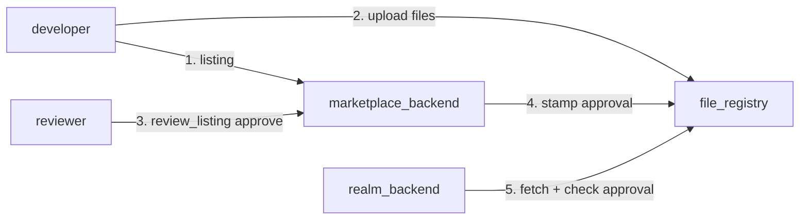

# Trust, the file registry and the marketplace

A realm runs code it did not ship with: extensions and codices. This page explains where that code
lives, who vouches for it, and how a realm decides to accept it.

## The pieces



| Canister | Role |
|---|---|
| [file_registry](https://github.com/smart-social-contracts/file-registry) | Stores package files by **namespace**: `ext/<id>/<version>/…`. It also keeps approval stamps (`get_namespace_approval_icc`). |
| `marketplace_backend` ([`src/marketplace_backend`](../../src/marketplace_backend)) | Listings, developer licences, reviewers. A reviewer's `review_listing` stamps the approval onto the registry. |
| `realm_backend` | Fetches a package, checks the trust policy, installs it. |

## What a package looks like in the registry

```text
ext/<id>/<version>/
├── manifest.json
├── backend/entry.py               an extension backend (when manifest "backend": true)
├── backend/hooks.py               a codex
├── frontend/dist/index.html, …    an extension UI
└── frontend/i18n/locales/*.json
```

Extensions and codices share the `ext/` prefix; a codex is the package whose manifest says
`"kind": "codex"`.

## The trust policy

Each realm sets its own policy, in the `trust_policy` setup step or later with the governed
`realm_configure_trust_policy`:

| Field | Default | Meaning |
|---|---|---|
| `require_marketplace_approval` | `true` | `false` accepts any code (only sensible on a local test realm). |
| `trusted_approvers` | `[]` | Entries `sha256:<hex>` **pin** an exact package. Other entries are **approver principals**. With no approver entries, the realm's marketplace is the approver. |

When the realm installs a package, `trust()` in
[`api/extensions.py`](../../src/realm_backend/api/extensions.py) computes the package checksum,

```python
sha256(json.dumps(manifest, sort_keys=True) + "\n" + source)
```

and accepts it when either:

1. `sha256:<checksum>` is pinned in `trusted_approvers`, or
2. the registry says the namespace is approved, and the approver is one the realm trusts.

Otherwise the install fails with a message such as
`ext/hello/1.0.0 is not approved by the marketplace (unapproved)`.

The install reply's `approved_by` records what vouched for the code: the pin, the approver, or `""`
when the realm requires no approval.

Pins are how a realm runs code the marketplace never saw: a codex installed with
`{"manifest", "source"}` instead of from the registry must be pinned.

## Who decides to install

Trust is necessary, not sufficient. `extension_install` and `codex_install` are **governed
realm-wide** operations: once the realm has a root policy, installing anything is a vote (see
[Governance](governance-and-delegation.md)). After that, `extension_set_access` decides which
profiles and departments see an extension.

## Locally

`realms local start` sets `require_marketplace_approval: false` on the local realm, so anything
you publish to the local registry installs without review. Production realms keep the default.
