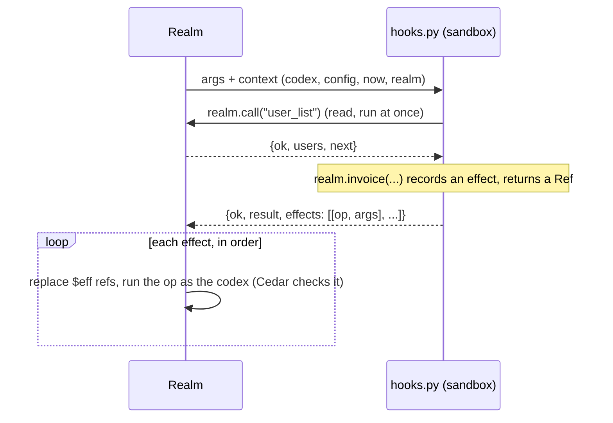

# Codex SDK (`ggg_sdk`)

Every hook imports one module:

```python
from ggg_sdk import hook, realm, key
```

It is plain Python with no imports of its own. The realm loads it into the sandbox next to the
codex's `hooks.py` (its source is in [`core/sdk.py`](../../src/realm_backend/core/sdk.py)). The
hook's only way out of the sandbox is `realm.call` for declared read operations; time comes from
`realm.now`.

## `@hook`

```python
@hook
def on_user_register(args):
    ...
    return {"anything": "json-like"}
```

`@hook` turns `fn(args)` into what the realm calls. It clears the effect list, runs the function,
and returns `{ok: true, result, effects}`. If the function raises, it returns
`{ok: false, error: "ValueError: ..."}` and **no effect is applied**.

## How a hook runs



- **Reads** (`realm.call`, `realm.every`) run while the hook runs, and only for read operations
  listed in `capabilities`.
- **Writes** (`realm.effect` and the helpers built on it) only record `[op, args]`. They run after
  the hook returns, one by one, each as its own operation. One that fails is reported in
  `codex_status` and does not stop the next.
- The hook has a budget of 10M instructions. At most 32 read operations may be declared.

## `realm`: reading

| Member | Value |
|---|---|
| `realm.config` | The codex manifest merged with the realm's `config_overrides` |
| `realm.setting(path, default=None)` | One value of `config` by dotted path: `realm.setting("fees.registration", 0)` |
| `realm.info` | Facts about the realm: `name`, `status`, `accounting_currency`, `accounting_currency_decimals`, `is_capital`, `is_quarter`, `open_registration` |
| `realm.stage` | `realm.info["status"]`: `setup`, `alpha`, `beta`, … |
| `realm.now` | The chain time, in seconds |
| `realm.currency` | `config.currency.symbol`, or else the realm's accounting currency |
| `realm.units(amount)` | Whole tokens to the smallest unit: `units(1.5)` is `150000000` with 8 decimals |
| `realm.context` | Everything above, raw: `{codex, config, now, realm}` |
| `realm.call(op, **args)` | Runs a read operation and returns its reply. Raises `RuntimeError("op: error")` if it fails. |
| `realm.every(op, key, **args)` | Yields every row of a paged read: `realm.every("department_list", "departments")` |
| `realm.members()` | Active members, from `user_list` (needs `user_list` in `capabilities`) |

## `realm`: writing

| Member | Records the effect |
|---|---|
| `realm.effect(op, **args)` | `[op, args]`, for any operation in `capabilities`. Returns a `Ref`. |
| `realm.invoice(user, amount, reason, days=30)` | `invoice_create` to `User:<user>`, `amount` in whole tokens, due in `days` |
| `realm.notify(user, title, body, topic="", href="")` | `notification_send` to `User:<user>` |
| `realm.configure(**fields)` | `realm_configure` |
| `realm.bill_members(amount, reason, title, body)` | An invoice and a notice to each active member who is not an admin; returns the count |
| `realm.run_payroll(period)` | `payroll_run` for each seeded department with a `fund` and a salaried position |
| `realm.seed()` | Creates the manifest's `seed`: departments (with policy, fund, profiles and positions) and the justice department's courts. Departments that already exist are skipped, so it is safe in `init`. |
| `realm.seed_department(d)`, `realm.seed_courts(courts, operator)` | The two halves of `seed`, for one department or a list of courts |

Each helper needs its operation in `capabilities` (`invoice_create`, `notification_send`, …).

### References to results

An effect has not run yet when the hook gets it back, so its result is not known. `realm.effect`
returns a `Ref` instead: `ref["invoice"]` is the placeholder `"$eff:0:invoice"`. The realm replaces
it with the real value before running a later effect, and in the hook's result.

```python
inv = realm.invoice(user, 10, "registration")          # effect 0
realm.notify(user, "Welcome", "Invoice " + inv["invoice"] + " is due in 30 days.")
return {"invoice": inv["invoice"]}                     # the real id, in the hook's result
```

`invoice_create` replies `{invoice, pay_to}`, so `inv["pay_to"]` works too. A reference to an
effect that failed stays as the placeholder text.

## `key(*parts)`

Builds the ids `seed` uses for a seat's profile and position:

```python
key("Citizenship & Identity", "kyc_officer")   # "citizenship-identity.kyc_officer"
```

## Example: agora

From [codices/agora/backend/hooks.py](https://github.com/smart-social-contracts/realms-codices/blob/refactor/slim/codices/agora/backend/hooks.py):

```python
@hook
def init(args):
    """Enforce the codex's registration policy, then seed departments, positions and courts (idempotent)."""
    wanted = {"open_registration": realm.setting("onboarding.registration.open_registration", False)}
    if not realm.info.get("name"):
        wanted["name"] = NAME
    if any(realm.info.get(k) != v for k, v in wanted.items()):
        realm.configure(**wanted)
    realm.seed()
    return {"codex": "agora"}


@hook
def on_stage_change(args):
    """Entering beta: every citizen gets a membership invoice and payroll starts."""
    if args.get("stage") != "beta":
        return {"skipped": args.get("stage")}
    fee = realm.setting("fees.monthly_membership") or realm.setting("fees.registration", 0)
    billed = 0
    if fee > 0:
        billed = realm.bill_members(fee, "membership", "Tax / membership fee due",
                                    "The realm has entered **beta**: taxes and fees are now active. Please settle "
                                    "your membership invoice (`%s %s`) in the *Invoices* section."
                                    % (fee, realm.currency))
    realm.run_payroll("beta")
    return {"invoiced": billed}
```

`init` only calls `realm_configure` when something differs, so running it again is cheap.
`on_stage_change` is written for `beta`, which no operation sets yet (see
[Hooks](README.md#hooks-codex_api_version-2)).
