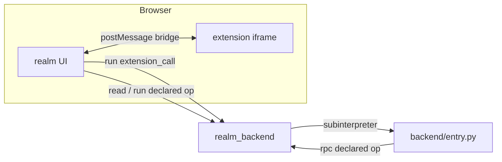

# Extensions

An **extension** adds a feature to a realm: a voting booth, a land registry, a member dashboard.
It is a package with a manifest, an optional Python backend and an optional web UI. Realms install
extensions from the file registry; the realm's governance decides which.

| Page | What it covers |
|---|---|
| [Manifest](manifest.md) | Every field of `manifest.json` |
| [Backend](backend.md) | Python functions that call realm operations, run in the sandbox |
| [Frontend](frontend.md) | The UI, in a sandboxed iframe, talking over the bridge |
| [Build, test, publish](build-test-publish.md) | From `realms new extension` to an installed extension |

## The package

```text
hello/
├── manifest.json        id, version, who sees it, which operations it may call
├── backend/entry.py     optional: Python functions (manifest "backend": true)
└── frontend/            optional: the UI; its build goes to frontend/dist/
```

## The one rule: declared operations

An extension never gets the realm's power. It gets **the user's** power, limited to the operations
its manifest declares:

```json
{ "operations": ["proposal_list", "proposal_vote"] }
```

- From the UI, `realm.read(...)` / `realm.run(...)` reach only these operations, as the user.
- From the backend, `rpc(...)` reaches only these operations, as the user.
- Cedar checks both conditions on every call: the operation is declared, and the user holds its
  permission (see [Authorization](../architecture/authorization.md)).

So an extension can do less than its user, never more, and a reviewer reads one list to see what
it can touch.

## Where it runs



- The UI runs in an iframe with an opaque origin ([Frontend](frontend.md)).
- The backend runs in a fresh subinterpreter per call, with an instruction budget
  ([Sandboxing](../architecture/sandboxing.md)).

## Do I need a backend?

Usually not. If the UI only reads and calls existing operations, declare them and skip the backend:
a frontend-only extension installs without any Python. Write a backend when one user action must
combine several operations, or when you want logic the UI should not hold.

## Lifecycle in a realm

| Operation | Governed | Does |
|---|---|---|
| `extension_install {extension, version}` | realm-wide | Fetches `ext/<id>/<version>/` from the registry, checks the [trust policy](../architecture/trust-and-registry.md), installs or upgrades. |
| `extension_set_access {extension, profiles, departments}` | realm-wide | Who gets it. At install: the manifest's `profiles` (default `member`). |
| `sidebar_configure {extension, sidebar}` | realm-wide | Menu label, category, icon, order. |
| `extension_uninstall {extension}` | realm-wide | Removes it. |
| `extension_list` | read | Installed extensions and whether each is available to you. |
| `extension_call {extension, function, args}` | no | Runs a backend function as you. |

## Status of the contract

These pages describe the contract of the current backend (the one with the `read`/`run` API).

The scaffolds (`realms new extension`, `npm create realms-extension`) and the first-party
extensions in [realms-extensions](https://github.com/smart-social-contracts/realms-extensions) still
follow the **previous** contract, the one released realms (up to v0.8.0-rc2) run. To move a package
to the current contract:

| | Previous | Current |
|---|---|---|
| Backend function | `def greet(args: str) -> str`: JSON text in and out | `def greet(name="World")`: keyword arguments in, plain data out |
| Manifest | no `operations`; `backend/` always shipped | an `operations` list; `"backend": true` ships `backend/entry.py` |
| Realm operations from the UI | through the extension's backend (`callExtension`) | directly: `realm.read` / `realm.run` for declared operations |
